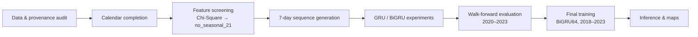

<div align="center">

# 🔥 SIGAP-GAMBUT

### Next-Day Peatland Hotspot Forecasting with BiGRU (Deep Learning)

**Time-series classification of wildfire / hotspot risk in Ogan Komering Ilir (OKI), South Sumatra, Indonesia, using VIIRS and ERA5-Land data.**


[](https://colab.research.google.com/github/Ihzaanandar/sigap-gambut-bigru-peatland-hotspot-forecasting/blob/main/sigap_gambut_bigru_peatland_hotspot_forecasting.ipynb)

[Overview](#-overview) · [Results](#-results-at-a-glance) · [Pipeline](#-pipeline) · [Quick Start](#-quick-start) · [Data](#-data-requirements) · [Limitations](#-limitations) · [Ringkasan Indonesia](#-ringkasan-bahasa-indonesia)

</div>

---

## 🌿 Overview

Peatland fires in Indonesia cause serious environmental, ecological, and public-health damage, including the haze that affects millions of people every dry season. **SIGAP-GAMBUT** asks a focused question:

> *Can the last 7 days of environmental and hotspot-related signals tell us whether at least one VIIRS hotspot will appear in the peatland area **tomorrow**?*

This project answers it with a **Bidirectional GRU (BiGRU)** model trained on daily data from **2018–2023**, validated with a **chronological walk-forward scheme** (2020–2023) to avoid time leakage, and tuned for **recall**, because missing a real hotspot day is costlier than a false alarm.

> ⚠️ **Scope:** this is a research and portfolio prototype, **not** an operational fire-alert system. It predicts next-day hotspot *occurrence* for the whole study area, not the exact coordinates of future hotspots.

### ✨ Highlights

- 🔁 **7-day sliding window → next-day (H+1) forecast**
- 🧠 **BiGRU64 + Dense16** with binary focal loss (γ = 4.0) for heavy class imbalance
- ⏱️ **Walk-forward validation** (no random shuffling of time series)
- 🎯 **Recall-oriented optimization** with year-and-class balanced sample weighting
- 🗓️ **Calendar-gap tracking** via a `calendar_observed` channel
- 🧪 **Notebook inference prototype** with date-based prediction and an interactive widget
- 🗺️ **Historical hotspot maps** on a 10 km grid of OKI

---

## 📊 Results at a Glance

Recall-optimized BiGRU64, evaluated with walk-forward development folds (2020–2023):

| Metric | Score |
|---|---:|
| Accuracy | **85.03%** |
| Recall | **37.61%** |
| Precision | 31.14% |
| F1-score | 32.61% |
| Balanced accuracy | 63.00% |
| MCC | 0.2459 |
| PR-AUC | 0.3694 |

In the architecture-selection stage, BiGRU64 reached 85.13% raw development accuracy with 30.66% recall; the recall-optimization step then raised recall to 37.61% at a similar accuracy.

> **How to read this:** hotspot days are rare, so accuracy alone is misleading. Look at recall, precision, balanced accuracy, PR-AUC, and MCC together. These are recorded experiment results, not a guarantee that a fresh run reproduces identical values across environments.

---

## 🧭 Pipeline



1. **Data and provenance audit:** validate the daily-cache schema and audit the grid-day panel.
2. **Calendar completion:** build a continuous daily timeline, flagging missing days with `calendar_observed`.
3. **Feature screening:** Chi-Square screening, using the `no_seasonal_21` feature set.
4. **Sequence generation:** 7 historical days predict the next day, with no target-day features used.
5. **Model experiments:** compare GRU/BiGRU configurations and recall-oriented tuning.
6. **Walk-forward evaluation:** chronological validation across 2020–2023.
7. **Final training:** BiGRU64 on 2018–2023 development data.
8. **Inference and visualization:** date-based prediction, a 7-day external-input interface, an interactive widget, and historical hotspot maps.

### Model configuration

| Component | Setting |
|---|---|
| Architecture | BiGRU (64 units) → Dense (16 units) |
| Dropout | 0.20 |
| Loss | Binary focal cross-entropy (γ = 4.0) |
| Learning rate | 0.00075 |
| Sample weighting | `class_year_balanced` |
| Input window | 7 days |
| Input channels | 22 per timestep (21 features + `calendar_observed`) |
| Target | `peat_hotspot_tomorrow` (binary) |

---

## 🚀 Quick Start

1. **Clone** the repository:
   ```bash
   git clone https://github.com/Ihzaanandar/sigap-gambut-bigru-peatland-hotspot-forecasting.git
   cd sigap-gambut-bigru-peatland-hotspot-forecasting
   ```
2. **Open the notebook** in Google Colab (button above) or Jupyter:
   `sigap_gambut_bigru_peatland_hotspot_forecasting.ipynb`
3. **Prepare the data** at the Google Drive paths listed in [Data Requirements](#-data-requirements).
4. **Run all cells top to bottom.** A dependency-install cell is included.
5. **Check the audit output** before interpreting results.
6. To regenerate the final model, run the final-training section (results may vary slightly by environment and hardware).

> The notebook uses Colab paths under `/content/drive/MyDrive/gemastik`. To run locally, change the Drive-mounting code and paths.

---

## 🗂️ Repository Structure

```text
sigap-gambut-bigru-peatland-hotspot-forecasting/
├── README.md
├── sample_dataset_gambut.xlsx
├── sigap_gambut_bigru_peatland_hotspot_forecasting.ipynb
└── models/
```

| File | Purpose |
|---|---|
| `sigap_gambut_bigru_peatland_hotspot_forecasting.ipynb` | Main notebook: workflow, experiments, evaluation, training, inference |
| `sample_dataset_gambut.xlsx` | Sample/reference workbook (not loaded directly by the training pipeline) |
| `models/` | Exported model artifacts, if included |

---

## 💾 Data Requirements

The sample workbook does **not** replace the source data required for training. The notebook expects data in Google Drive under `MyDrive/gemastik`.

**Primary daily cache** (the first one found is used; the notebook raises `FileNotFoundError` if neither exists):

```text
MyDrive/gemastik/data/model/training_simple_daily/cache/daily_dataset_simple.parquet
MyDrive/gemastik/data/model/training_v3_daily/cache/daily_dataset_v3.parquet
```

**Supporting artifacts** (for provenance audits and historical maps):

```text
MyDrive/gemastik/data/model/final/train_dataset_oki_hotspot_next_day_2018_2025.csv
MyDrive/gemastik/spatial/grid_oki_10km.geojson
```

The grid may alternatively be at `MyDrive/gemastik/scrapping data/spatial/grid_oki_10km.geojson`. Some audit, map, and reporting sections are unavailable if supporting files are missing.

### Model artifacts

Final training saves to `MyDrive/gemastik/data/model/gru_gemastik_2026_full_recall_optimized/models/`:

```text
bigru64_focal_g4_lr000075_recall_optimized.keras
bigru64_recall_optimized_preprocessor.joblib
bigru64_recall_optimized_manifest.json
```

---

## ⚠️ Limitations

- **Daily, region-level output:** it does not forecast exact hotspot coordinates.
- **Maps show observations:** the map section visualizes historical hotspots, not a spatial forecast.
- **No live data ingestion:** future-date predictions need 7 days of external features prepared with the same upstream definitions.
- **Score, not probability:** the sigmoid output is a risk score compared with a development-derived threshold, not a calibrated probability.
- **Legacy 2024–2025 period:** it appeared in earlier experiments, so it should not be treated as a pristine unseen test set.
- **Reproducibility:** results depend on source data, feature generation, package versions, and hardware.

---

## 🙏 Data Sources & Acknowledgments

- [NASA FIRMS](https://firms.modaps.eosdis.nasa.gov/): VIIRS fire/hotspot observations
- [Copernicus Climate Data Store](https://cds.climate.copernicus.eu/): ERA5-Land meteorological and land-surface variables
- [Global Forest Watch](https://www.globalforestwatch.org/) / WRI: peatland mask
- [WorldPop](https://www.worldpop.org/): contextual population data (not a model predictor)
- [geoBoundaries](https://www.geoboundaries.org/): administrative boundaries

Check source files and preprocessing decisions against the manifests of the original data-preparation workflow.

---

## 🇮🇩 Ringkasan Bahasa Indonesia

**SIGAP-GAMBUT** adalah proyek *deep learning* untuk **prediksi hotspot kebakaran lahan gambut H+1** di **Ogan Komering Ilir (OKI), Sumatera Selatan**. Model **BiGRU** memakai data 7 hari terakhir (VIIRS, ERA5-Land, dan fitur lingkungan lain) untuk memperkirakan apakah akan muncul hotspot pada hari berikutnya. Validasi memakai *walk-forward* (2020–2023) dan optimasi difokuskan pada **recall**. Proyek ini dibuat untuk **GEMASTIK XIX 2026** (Divisi Data Science) dan merupakan prototipe riset, bukan sistem peringatan dini operasional.

---

**Keywords:** peatland hotspot prediction, peatland fire forecasting, wildfire risk prediction, hotspot forecasting Indonesia, kebakaran lahan gambut, prediksi hotspot, time-series classification, BiGRU, GRU, TensorFlow, Keras, VIIRS, ERA5-Land, environmental data science, GEMASTIK XIX 2026, Ogan Komering Ilir, South Sumatra.
